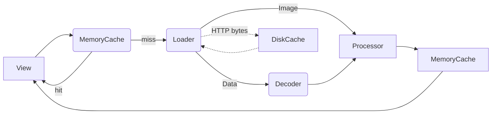

# ImageKit

Lightweight image loading for UIKit, AppKit, and SwiftUI.



## Feature
1. Cache: Memory (decoded) · Disk (raw bytes for network)
1. Loader: Local · Network
1. Decoder: Image · Gif
1. Processor: Predrawn · Gray

https://github.com/user-attachments/assets/a66e6534-51d5-46a7-a54b-10847446486a

## Usage

### SwiftUI

```swift
// Default loading / success / error UI
ImageView(url: url, size: .absolute(size))

// Configure a request once and use it across UI frameworks or async loading
let request = ImageRequest(url, size: .absolute(size), mode: .fit,
                           processors: [.gray, .predrawn])
ImageView(request: request)

// Own every phase
ImageCustomView(request: request) { phase in
    switch phase {
    case .empty:
        ProgressView()
    case .success(let image):
        #if os(macOS)
        Image(nsImage: image).resizable().scaledToFill()
        #else
        Image(uiImage: image).resizable().scaledToFill()
        #endif
    case .failure:
        Text("error")
    }
}
```

### UIKit / AppKit

```swift
imageView.setImage(url: url)
imageView.setImage(request: request)
imageView.cancelImageLoad()
```

### Async loading

```swift
let image = try await request.send()
```

Requests default to automatic animation detection from image data. Use
`animation: .firstFrame` for a static image or `animation: .animated` to enable
animation explicitly. The existing `isGif` parameter remains supported.
Animated playback is supported on iOS; macOS returns the first frame.

Custom loaders can implement `loadResult(request:)` to propagate errors. Existing
`DataLoader` implementations remain supported through the default adapter.

SwiftUI request views retain their loading state and reload when the resource or
request options change. Leaving the view cancels its subscription. Cancelling one
subscriber does not cancel other subscribers sharing the same load.
